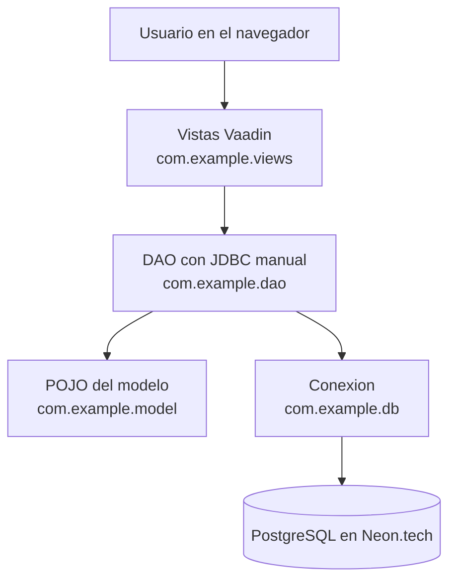
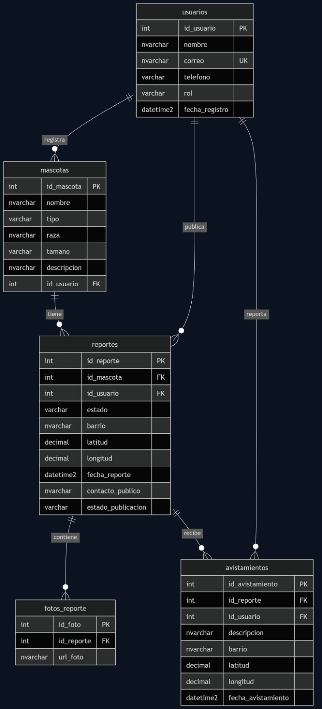

# 🐾 Mascotas Bello

**Sistema web de reporte, búsqueda y geolocalización de mascotas perdidas, encontradas y en adopción**


**Proyecto Integrador: Configuración, Modelado y CRUD (Avance 1)** · Institución: Cesde · Ubicación: Bello, Antioquia

---

## Tabla de contenido

1. [Resumen ejecutivo](#1-resumen-ejecutivo)
2. [Arquitectura](#2-arquitectura)
3. [Modelo de datos](#3-modelo-de-datos)
4. [Stack tecnológico](#4-stack-tecnológico)
5. [Guía de configuración y ejecución](#5-guía-de-configuración-y-ejecución)
6. [Flujo de trabajo y control de versiones](#6-flujo-de-trabajo-y-control-de-versiones)
7. [Licencia y créditos](#7-licencia-y-créditos)

---

## 1. Resumen ejecutivo

**Problema.** En Bello, Antioquia, la información sobre mascotas perdidas, encontradas y en adopción está dispersa en redes sociales y grupos de mensajería. Las publicaciones pierden visibilidad rápido y casi nunca traen fotografías claras, ubicación precisa o un contacto confiable.

**Solución.** *Mascotas Bello* es una aplicación web empresarial desarrollada en **Java con Vaadin** que centraliza los reportes en una base de datos relacional **PostgreSQL alojada en Neon.tech**. El acceso a datos se hace con **JDBC y SQL escrito manualmente** (sin Hibernate ni anotaciones de mapeo), usando clases POJO que representan el modelo entidad-relación.

**Valor del sistema.** Facilita que las mascotas se reencuentren con sus familias, mejora la difusión de los casos y da visibilidad a los animales que necesitan un hogar.

**Alcance del Avance 1.** Infraestructura técnica, conexión a la base de datos remota, capa de persistencia manual y una interfaz Vaadin con las operaciones **CRUD** (crear, leer, actualizar y eliminar) para **cada una de las 5 entidades** del modelo.

| Entidad | Ruta en la aplicación |
|---|---|
| Usuarios | `/usuarios` |
| Mascotas | `/mascotas` |
| Reportes | `/reportes` |
| Fotos de reportes | `/fotos` |
| Avistamientos | `/avistamientos` |

## 2. Arquitectura

La aplicación se organiza en capas para separar la interfaz, el acceso a datos y la base de datos.



| Capa | Paquete | Responsabilidad |
|---|---|---|
| Presentación | `com.example.views` | Pantallas Vaadin: tabla, formulario en ventana, validación de datos y mensajes al usuario. `CrudView` es la pantalla CRUD genérica que reutilizan las 5 entidades. |
| Acceso a datos | `com.example.dao` | Un DAO por entidad (`UsuarioDAO`, `MascotaDAO`, ...) con consultas SQL manuales mediante `PreparedStatement`. Todos cumplen la interfaz `CrudDAO<T>`. |
| Modelo | `com.example.model` | Clases POJO que representan cada tabla (`Usuario`, `Mascota`, `Reporte`, `FotoReporte`, `Avistamiento`). |
| Infraestructura | `com.example.db` | `Conexion` (abre conexiones JDBC leyendo credenciales externas) y `DatabaseException` (errores de BD con mensajes entendibles). |

**Reglas de negocio implementadas**

- Un reporte puede tener **máximo 3 fotografías**.
- El correo de cada usuario es **único**.
- Las coordenadas se validan en rango (latitud −90 a 90, longitud −180 a 180).
- No se puede eliminar un registro que otros registros referencian (integridad referencial); la aplicación muestra un mensaje claro.

## 3. Modelo de datos



Relaciones principales:

- Un **usuario** registra varias **mascotas**, publica varios **reportes** y reporta varios **avistamientos**.
- Una **mascota** puede tener varios **reportes** a lo largo del tiempo.
- Un **reporte** puede tener varias **fotografías** (máximo 3) y recibir varios **avistamientos**.

El script de creación está en [`sql/schema.sql`](sql/schema.sql) y datos de ejemplo opcionales en [`sql/datos_prueba.sql`](sql/datos_prueba.sql).

## 4. Stack tecnológico

| Tecnología | Versión | Uso |
|---|---|---|
| Java (JDK) | 25 | Lenguaje principal |
| Vaadin Flow | 25.3.0 | Interfaz web en Java |
| Spring Boot | 4.1.1 | Arranque y configuración de la aplicación |
| PostgreSQL | Neon.tech (remoto) | Base de datos relacional |
| Driver JDBC `org.postgresql:postgresql` | Versión gestionada por Spring Boot | Conexión a PostgreSQL |
| Maven (Maven Wrapper `mvnw`) | Incluido en el repositorio | Compilación y dependencias |
| Git / GitHub | — | Control de versiones y colaboración |

> La persistencia se implementa con **JDBC puro**: no se usa Hibernate ni JPA en este avance.

## 5. Guía de configuración y ejecución

### Pre-requisitos

- **JDK 25** instalado (`java -version`).
- **Git**.
- Una cuenta en [Neon.tech](https://neon.tech) con un proyecto y una base PostgreSQL creados.
- No necesitas instalar Maven: el repositorio incluye el *wrapper* (`mvnw`).

### Paso a paso

1. **Clonar el repositorio**
   ```bash
   git clone <URL-DEL-REPOSITORIO>
   cd proyecto-integrador-b1-2026-2-g4
   ```

2. **Crear las tablas en Neon.** Abre el *SQL Editor* de tu proyecto en Neon, pega el contenido de `sql/schema.sql` y ejecútalo. (Opcional: `sql/datos_prueba.sql` para cargar datos de ejemplo.)

3. **Configurar las credenciales** (variables de entorno o archivo local, a elección):

   - **Opción A, archivo `db.properties` (recomendada):** copia `src/main/resources/db.properties.example` como `src/main/resources/db.properties` y completa tus datos:
     ```properties
     db.url=jdbc:postgresql://TU-HOST.neon.tech/neondb?sslmode=require
     db.user=TU_USUARIO
     db.password=TU_CONTRASENA
     ```
   - **Opción B, variables de entorno:** `DB_URL`, `DB_USER` y `DB_PASSWORD` (tienen prioridad sobre el archivo).

   > `db.properties` está en `.gitignore`: **nunca se sube al repositorio**. Usa en la URL solo `?sslmode=require`.

4. **Compilar y ejecutar**
   ```bash
   # Linux / macOS
   ./mvnw spring-boot:run

   # Windows
   mvnw.cmd spring-boot:run
   ```

5. **Abrir** <http://localhost:8080>. Desde el menú **Administración** accedes a los CRUD de cada entidad.

### Notas

- La primera consulta puede tardar unos segundos si Neon tiene la base en reposo (*autosuspend*).
- Para generar el JAR de producción: `./mvnw clean package -Pproduction`.

## 6. Flujo de trabajo y control de versiones

El equipo trabaja con **Git y GitHub** siguiendo un flujo por ramas:

1. `main` contiene la versión estable y siempre debe compilar.
2. Cada integrante trabaja en una rama propia por tarea: `feature/<tarea>` (por ejemplo `feature/crud-usuarios`).
3. Los cambios se integran a `main` mediante *Pull Request* con revisión de al menos un compañero.
4. Los commits siguen la convención de **commits semánticos**:

   | Prefijo | Uso | Ejemplo |
   |---|---|---|
   | `feat:` | Nueva funcionalidad | `feat: agrega CRUD de usuarios` |
   | `fix:` | Corrección de errores | `fix: valida formato de correo` |
   | `docs:` | Documentación | `docs: agrega diagrama MER al README` |
   | `chore:` | Configuración y mantenimiento | `chore: agrega driver JDBC de PostgreSQL` |
   | `refactor:` | Mejora interna sin cambiar el comportamiento | `refactor: extrae CrudView genérico` |

## 7. Licencia y créditos

Proyecto académico desarrollado en el contexto del **Proyecto Integrador** (Desarrollo Web con Vaadin) de **Cesde**. La licencia de distribución está pendiente de definición por el equipo (ver [`LICENSE.md`](LICENSE.md)).

**Equipo de trabajo**

| Integrante | Rol / responsabilidad |
|---|---|
| Luis David Romero Chaverra | Interfaz principal y documentación |
| Thamara Taborda | Registro y administración de mascotas |
| David Colorado Gómez | Búsqueda, base de datos y geolocalización |
